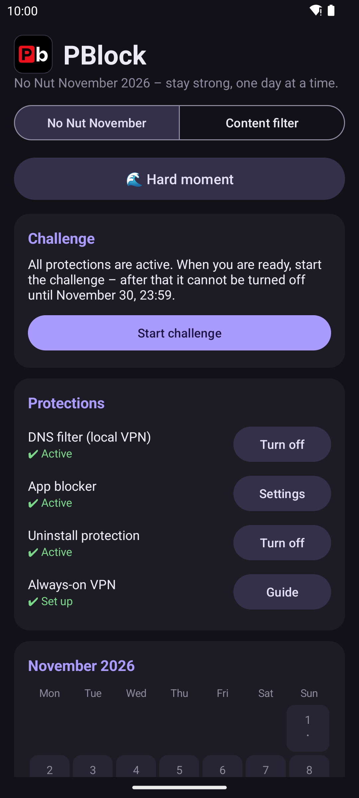
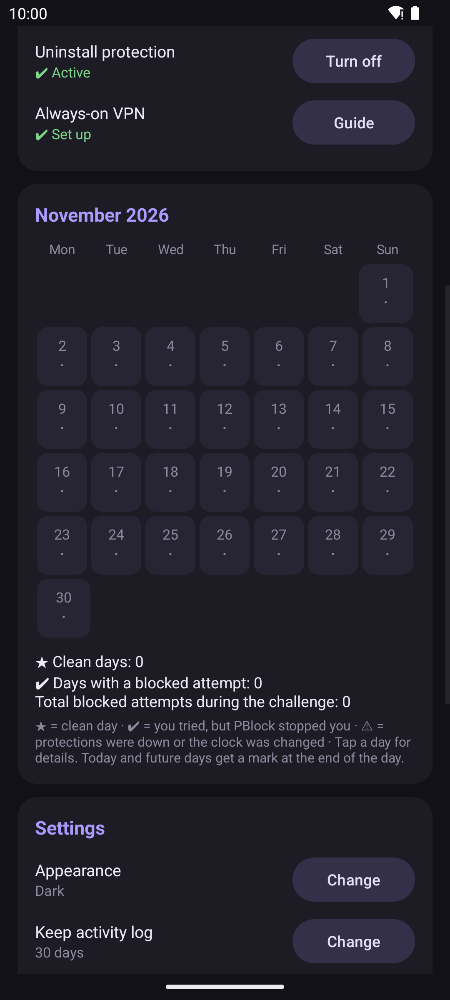
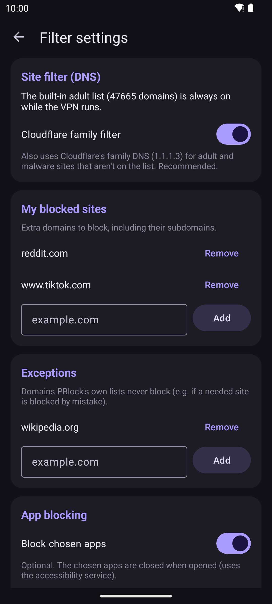
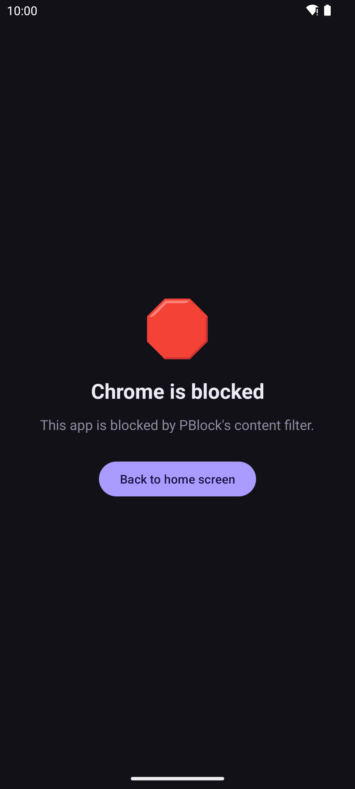

# PBlock

PBlock is an Android app that helps young people get through the **No Nut November** challenge, and that parents or anyone else can use as a **general content filter**. It blocks adult websites on the device, can close chosen apps, and – once you commit – locks its own protections so they can't be switched off in a weak moment.

Made by **SAWorks**.

<p>
  
  
  
  
</p>

## Install

Download the APK from [Releases](https://github.com/Hazelsurai/PBlock/releases) (Android 10 or newer). On Android 13 and newer, sideloaded apps start with the accessibility switch greyed out ("Restricted setting"): open *Settings → Apps → PBlock → ⋮ → Allow restricted settings* first. Then follow the setup checklist in the app.

Release APKs are signed by SAWorks. Signing certificate SHA-256:
`65:FC:AA:29:FD:73:06:1E:4B:9F:05:D0:49:34:4C:17:73:02:F7:88:A9:09:3E:07:F8:42:E3:B5:AC:A4:45:28`

## Features

- **No Nut November mode** – a challenge for November 2026. After you start it (by typing a confirmation word), the protections stay locked until November 30, 2026, 23:59 (Budapest time), then everything unlocks automatically.
- **Content-filter mode** – a general filter without the challenge, with an optional time lock or parent-PIN lock.
- **Site filter (DNS)** – a built-in adult blocklist (StevenBlack/hosts "porn-only") including all subdomains and the `.xxx`, `.porn`, `.sex` and `.adult` endings, plus optional Cloudflare for Families DNS (1.1.1.3 / 1.0.0.3). You can add your own blocked sites and exceptions.
- **App blocker** – closes chosen apps when they are opened (Brave, X and Telegram during the challenge, or any launchable app in content-filter mode).
- **Uninstall protection** – while a lock is active, PBlock cannot be uninstalled and its setup pages in the Settings app are locked.
- **Calendar and statistics** – clean days, days with a blocked attempt, and warnings when the protections were down or the clock was changed.
- **"Hard moment" screen** – a box-breathing exercise for when you are struggling.
- **Tamper detection** – detects clock changes (with network time sync), safe-mode boots and protection gaps.
- **Activity log** – kept only on the phone, with adjustable retention. With a parent PIN it can only be viewed with the PIN.
- **Bug report** – the app prepares a report, you review it, and it is sent from your own e-mail app. Nothing is sent automatically.
- System, light and dark themes. Per-app language.

## How it works

PBlock uses three standard Android mechanisms. You turn each one on yourself.

1. **Local DNS VPN** (`VpnService`) – only DNS traffic is routed into the app. Blocked domains get an NXDOMAIN ("does not exist") answer. Allowed queries are forwarded to the upstream DNS server. Other traffic does not go through the VPN at all. Using it as an *Always-on VPN* is recommended (but **not** "Block connections without VPN").
2. **Accessibility service** – watches which app is in the foreground so it can close blocked apps. While a lock is active, it also keeps you from disabling PBlock in Settings: for that it reads the screen text of the Settings app only, to recognise PBlock's own pages. Nothing is stored or sent.
3. **Device admin** – used only to prevent uninstalling while a lock is active.

## Privacy

PBlock has no accounts, no analytics, no ads and no tracking. The activity log, settings and diagnostics stay on the device. The only network traffic PBlock itself causes is:

- **DNS forwarding** of the queries your apps make: to Cloudflare for Families (1.1.1.3, 1.0.0.3) when the family filter is on, otherwise (or as a fallback) to the DNS servers of your current network. Google DNS (8.8.8.8) is used as a last fallback.
- **Time sync** to detect clock tampering: NTP (time.cloudflare.com, time.google.com, pool.ntp.org), or the `Date` header of an HTTPS request to google.com / cloudflare.com as a fallback.

A bug report leaves the device only if you send it yourself from your e-mail app, and you can see exactly what it contains first.

## Known limitations and bypasses

PBlock makes slipping up harder. It is not unbreakable, and a determined person with full access to the phone can get around it.

- **Encrypted DNS bypasses the filter**: Private DNS set to a custom provider, "Secure DNS" / DNS-over-HTTPS in Chrome, Firefox, Edge, Opera and others, or browsers with a built-in VPN. PBlock warns about Private DNS. The in-app tips explain how to turn the rest off.
- **Another VPN app** replaces PBlock's VPN, because Android allows only one VPN at a time.
- **Filtering is by domain only.** It cannot see page content, images, or sites reached by raw IP address, and no blocklist is complete.
- **Safe mode, a factory reset, or ADB / a computer** can remove the protections. Safe-mode boots and protection gaps are detected and marked in the calendar, but not prevented.
- Some phone makers' Settings apps differ, so locking the setup pages may not work on every device.
- The challenge dates are fixed to November 2026 (Budapest time).

## Building

Requirements: Android Studio (or JDK 17+ and the Android SDK) with compileSdk 36. minSdk is 29 (Android 10).

```
./gradlew testDebugUnitTest lintDebug assembleDebug
./gradlew assembleRelease
```

By default the release build is **unsigned**. To sign it with your own keystore, point the Gradle property `pblockSigningProps` (for example in `~/.gradle/gradle.properties`) or the `PBLOCK_SIGNING_PROPS` environment variable at a properties file kept outside the repository, containing `storeFile`, `storePassword`, `keyAlias` and `keyPassword`. Keystores, signing properties and `local.properties` are git-ignored and must never be committed.

The release build is meant to be **reproducible**: it contains no VCS info or dependency metadata block, and all text files use LF line endings (`.gitattributes`), so an unsigned build from the same tag gives the same APK contents on Windows and Linux. Store descriptions and screenshots for F-Droid live in `fastlane/metadata/android/`.

## Languages

English (default), Hungarian, German, Russian, Simplified Chinese, Brazilian Portuguese and Japanese.

## Contact

Bug reports and suggestions: **saworksl1dev@gmail.com** (or use *Report a problem or suggestion* in the app).

## Support

If PBlock helps you, you can support development on Ko-fi: [ko-fi.com/haxicgamerhun83232](https://ko-fi.com/haxicgamerhun83232). The app is and stays free, with no ads.

## License

Licensed under GPL-3.0. See [LICENSE](LICENSE).

## Credits

The built-in blocklist comes from [StevenBlack/hosts](https://github.com/StevenBlack/hosts) (MIT, see `app/src/main/assets/LICENSE-StevenBlack-hosts.txt`), which combines Sinfonietta/hostfiles (MIT), Clefspeare13/pornhosts (MIT), bigdargon/hostsVN (MIT), tiuxo/hosts (CC BY 4.0) and brijrajparmar27/host-sources (CC BY 4.0). Thanks to Steven Black and the list maintainers. The credit is also shown in the app (the licenses button on the main screen).

Optional family DNS filtering: [Cloudflare for Families](https://one.one.one.one/family/) (1.1.1.3 / 1.0.0.3).

Libraries: AndroidX (Core, AppCompat, SplashScreen) and Material Components for Android, all Apache-2.0. No proprietary libraries or Google Play Services.

---

## Magyarul

A PBlock egy Android-alkalmazás, amely segít a fiataloknak végigcsinálni a **No Nut November** kihívást, és amelyet szülők vagy bárki más **általános tartalomszűrőként** is használhat. Helyi DNS-VPN-nel tiltja a felnőtt oldalakat, bezárja a kiválasztott alkalmazásokat, és a kihívás alatt (vagy idő- / szülői PIN-zárral) zárolja a saját védelmeit. Nincs fiók, nincs analitika. Az eszközt csak a DNS-lekérdezések továbbítása (Cloudflare családi DNS) és az időszinkron hagyja el. Hibabejelentés: saworksl1dev@gmail.com. Licenc: GPL-3.0. A beépített tiltólista forrása a [StevenBlack/hosts](https://github.com/StevenBlack/hosts) (MIT licenc), köszönet érte.

Támogatás: ha hasznos neked a PBlock, a fejlesztést a Ko-fi-on támogathatod: [ko-fi.com/haxicgamerhun83232](https://ko-fi.com/haxicgamerhun83232). Az alkalmazás ingyenes, és az is marad, reklámok nélkül.
